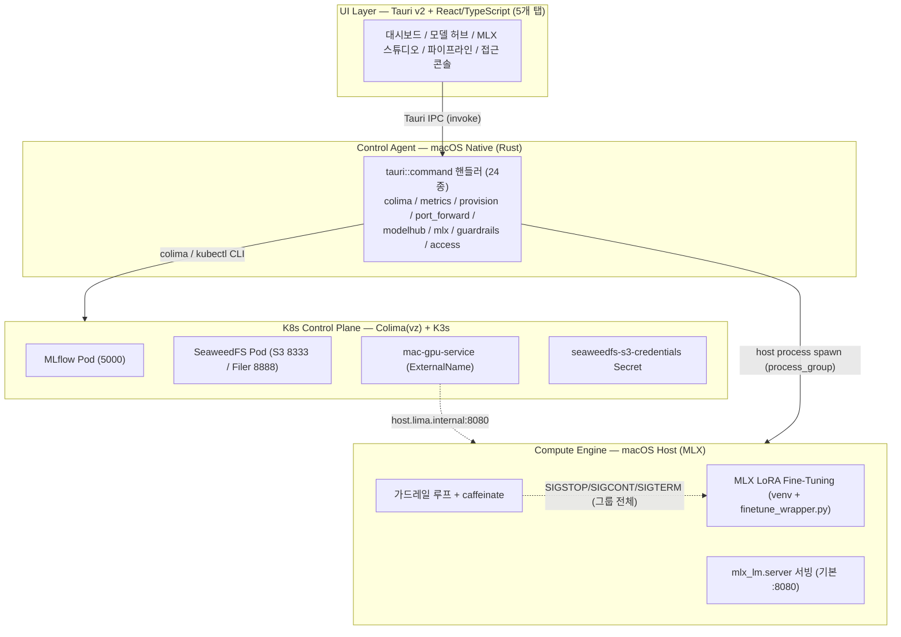
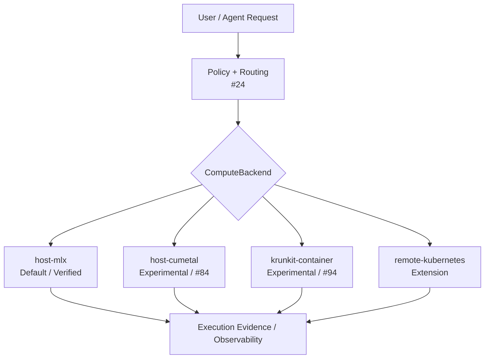
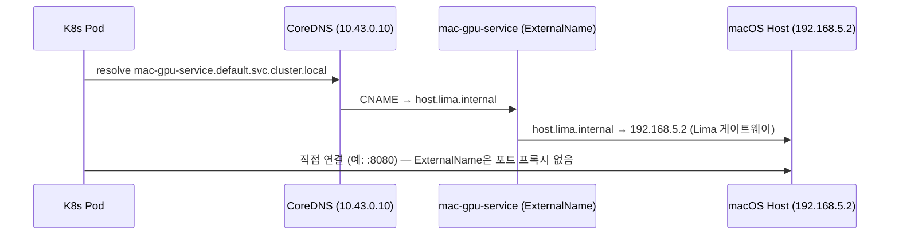

# 04. 전체 아키텍처

KubeMetal의 4계층 아키텍처, IPC 커맨드 흐름, 포트 맵, K8s↔호스트 브릿지를 정리합니다.
설계 결정(D1~D12)의 canonical 출처는 [docs/03-mvp-design.md §4](03-mvp-design.md#4-설계-결정-및-주의사항)이며,
본 문서는 그 결정을 인용만 하고 재서술하지 않습니다.

## 1. 전체 아키텍처 (4계층)



- **UI Layer**: React/TS 프론트엔드, 5개 탭(대시보드/모델 허브/MLX 스튜디오/파이프라인/
  접근 콘솔)으로 구성. `useColima`, `useMetrics` 등 훅으로 백엔드 IPC 커맨드를 호출.
- **Control Agent**: Rust `tauri::command` 계층. Colima/K3s 라이프사이클, 시스템 메트릭,
  매니페스트 프로비저닝, 포트포워딩, 모델 허브, MLX 파인튜닝/서빙, 하드웨어 가드레일,
  서비스 접근 콘솔을 담당(24개 커맨드, §2 참고).
- **K8s Control Plane**: Colima(`vz` + `virtiofs`) 위 K3s. MLflow/SeaweedFS 파드,
  SeaweedFS S3 크리덴셜 Secret, `mac-gpu-service` ExternalName이 존재한다. **현재 검증된
  기본 경로에서는** GPU 연산 워크로드를 K3s 내부에서 실행하지 않고 컨트롤 플레인 역할에
  집중한다.
- **Compute Engine**: 현재 기본 구현은 macOS 호스트에서 직접 실행되는 MLX 프로세스다.
  파인튜닝 래퍼는 `process_group(0)`으로 기동되어 가드레일 루프가 SIGSTOP/SIGCONT를
  그룹 전체로 보내도 자식 학습 프로세스까지 함께 멈춘다(D17). 추가 backend는 기존 경로를
  대체하지 않고 별도 capability/evidence gate를 통과한 뒤 확장한다.


### 1.1 ComputeBackend 확장 모델

KubeMetal의 장기 방향은 특정 런타임 하나를 모든 AI workload의 실행 환경으로 고정하지 않고
명시적인 `ComputeBackend` 계약으로 분리하는 것이다.



| Backend | 실행 경계 | 현재 상태 | 핵심 검증 |
|---|---|---|---|
| `host-mlx` | macOS host native | **기본 / 실측 검증** | MLX 학습·서빙, 메모리/thermal guardrail |
| `host-cumetal` | macOS host compatibility layer | **Experimental** | CUDA API/workload correctness·성능 (#84) |
| `krunkit-container` | Colima guest/container | **Experimental** | GPU container → K3s Pod → scheduling boundary (#94) |
| `remote-kubernetes` | 외부 K8s accelerator cluster | **확장 경로** | capability/data-boundary/routing (#24) |

#### krunkit 검증 경계

Colima 0.10+의 `krunkit` GPU-accelerated container 경로는 새로운 가능성이지만 다음을
서로 다른 capability로 취급한다.

```text
GPU container 실행 가능
        !=
K3s Pod에서 GPU 사용 가능
        !=
Kubernetes가 GPU를 allocatable resource로 관리 가능
        !=
DRA / Kueue 적용 가능
```

따라서 #94에서 아래를 실측하기 전에는 README/UI/API에서 "Kubernetes GPU 지원"으로
표현하지 않는다.

1. K3s Pod 내부 실제 GPU 실행 provenance
2. accelerator discovery / allocation semantics
3. multi-Pod isolation / accounting
4. restart/recreate 안정성
5. host MLX 대비 성능·메모리·thermal 특성

DRA/Kueue는 위 조건을 만족하는 **실제 Kubernetes 관리 가능 resource**가 존재함이 확인된
이후 별도 integration issue로 분리한다. 단순히 VM 또는 container에서 GPU API 호출이
성공했다는 이유로 가상의 `gpu=1` resource abstraction을 만들지 않는다.

## 2. IPC 커맨드 흐름

전체 24개 커맨드의 시그니처/설명은 [docs/02-requirements.md §4.1](02-requirements.md#41-tauri-rust-commands-frontend--backend-ipc)이 canonical 출처다. 아래는 기능군별 요약.

| 기능군 | 커맨드 | 설명 |
|--------|--------|------|
| 클러스터 제어 | `get_system_metrics` | sysinfo 기반 RAM/CPU 사용률 조회 (D2) |
| | `get_cluster_status` | `colima --profile <profile> status --json` 파싱 + MLflow/SeaweedFS 파드 준비 상태 조회 |
| | `start_cluster` | 감지된 호스트 RAM 기준 clamp된 cpu/memory로 `colima --profile <profile> start` 실행 |
| | `stop_cluster` | `colima --profile <profile> stop` 실행 (포트포워딩 정리 선행) |
| | `provision_mlops_stack` | `scripts/k8s/`의 Secret + MLflow + SeaweedFS + mac-gpu-bridge 매니페스트 4종을 `kubectl apply` (D18: `resolve_bundled_resource`로 번들 `_up_/` 평탄화 경로 해석) |
| | `start_port_forward` / `stop_port_forward` | MLflow/SeaweedFS S3/Filer 3개 포트포워딩 자식 프로세스 spawn/종료 |
| 모델 허브 (Phase 2b) | `search_hf_models`, `download_hf_model`, `get_model_downloads`, `list_local_models` | Hugging Face 검색·다운로드(`~/.kubemetal/models/`)·진행 상태·로컬 목록 조회 |
| | `upload_model_to_storage`, `register_model_mlflow` | SeaweedFS S3(`models` 버킷) 업로드 → MLflow Model Registry 등록 |
| MLX 스튜디오 (Phase 2c) | `check_mlx_env`, `setup_mlx_env` | `~/.kubemetal/venv`의 python3/mlx-lm 상태 조회·설치 |
| | `run_mlx_finetune` | venv python으로 `scripts/mlx/finetune_wrapper.py`(D18 경로 해석) 실행, `process_group(0)`으로 기동(D17). D47: 유일한 파인튜닝 경로(Prefect 플로우 제거). D49: mlx-lm save-completed 로그에서 immutable 검증 snapshot을 기록하고 checkpoint 이벤트를 emit; Failed/Killed source만 새 attempt로 weights warm-start한다. mlx-vlm resume은 지원하지 않는다. D45: staging `out/`에만 출력; exit 0·기대 done 경로·manifest 검증 후 삭제와 같은 admission mutex 아래 최종 이름으로 배타적 승격해야 done |
| | `get_mlx_status`, `kill_mlx_process` | 환경/학습/서빙 통합 상태 조회, SIGTERM→SIGKILL 종료(학습은 그룹 전체 대상; 리더 선종료 시 TERM 전 자식의 시작 시각·PGID·native argv의 MLX 신원을 재검증하며 증거가 없으면 거부, D17) |
| | `start_model_serving`, `stop_model_serving` | `mlx_lm server` 기동/정지. D48: 어댑터를 서빙하기 전 `adapter_serving_gate`(`services/mlx_artifacts.rs`, `verify_manifest` 재사용)로 manifest를 검증한다. 변조/누락/추가 파일이 있으면 spawn 없이 거부, manifest 없는 레거시 어댑터는 검증 없이 서빙(UI 미표시). 해싱은 `spawn_blocking`. `revert_to_last_serving`은 실행 중 서버를 멈추기 전에 같은 게이트를 먼저 건다 |
| | `list_registered_models` | MLflow Model Registry 조회 → 파이프라인 뷰 "등록" 단계 노출 (FR-08) |
| 접근 콘솔 (Phase 2d) | `get_service_access` | MLflow/SeaweedFS S3·Filer/Model Serving 4종 헬스 + S3 크리덴셜 Secret 조회 (FR-09) |
| 하드웨어 가드레일 (Phase 3) | `get_guardrail_status`, `set_guardrail_config` | memory pressure(D16)·배터리 상태 조회, 배터리 시 자동 일시정지 설정 |
| | `pause_mlx_training`, `resume_mlx_training` | 학습 프로세스 그룹에 SIGSTOP/SIGCONT (D17) |

### 프론트 훅 매핑

| 훅 | 갱신 주기 | 호출 커맨드 |
|----|-----------|-------------|
| `useMetrics` | 1000ms | `get_system_metrics` |
| `useColima` | 5000ms | `get_cluster_status` (+ `start_cluster` 트리거) |

발열(고온 시 배치 축소) 가드레일과 powermetrics 기반 Metal GPU 모니터링은 아직 커맨드로
노출되지 않는다 — docs/01-proposal.md §7 로드맵의 Phase 3 미착수 항목.

## 3. 포트 맵 (D1)

| 서비스 | 호스트 포트 | 대상 |
|--------|-------------|------|
| MLflow | 5001 | `svc/mlflow` 5000 (5000은 macOS AirPlay Receiver 점유) |
| SeaweedFS S3 API | 8333 | `svc/seaweedfs` 8333 |
| SeaweedFS Filer UI | 8888 | `svc/seaweedfs` 8888 |
| 모델 서빙 (Phase 2) | 8080 | 호스트 `mlx_lm.server` / `llama-server` (설정 가능) |

## 4. K8s ↔ 호스트 브릿지



`mac-gpu-service`는 `default` 네임스페이스의 `ExternalName` Service로, `host.lima.internal`을
가리키는 DNS CNAME 별칭일 뿐 포트 프록시를 수행하지 않는다 — 클라이언트가 대상 포트를
직접 지정해 연결해야 한다.

## 5. 실측 검증된 사실 (colima 0.10.3, tauri 2.11.5)

- (2026-07-20) `colima --profile <profile> status --json`은 기동 중일 때만 exit 0 + 평면 JSON
  (`{"kubernetes": bool, ...}`)을 출력한다. `status` 필드는 존재하지 않으며, 미기동 시
  exit 1 + stdout 없음.
- (2026-07-20) `mac-gpu-service` → `host.lima.internal` → `192.168.5.2` CNAME 체인이
  파드 내부 busybox nslookup으로 정상 해석됨을 확인했다.
- (2026-07-20) MLflow(5001), SeaweedFS S3(8333)·Filer UI(8888) 포트포워딩 후 각각 HTTP
  200 / `ListAllMyBucketsResult` 응답을 curl로 확인했다.
- (2026-07-21) `pnpm tauri build`로 생성한 `.app` 번들 실측: `resource_dir()`은 항상
  `Contents/Resources`를 가리키지만, `tauri.conf.json`의 `../scripts/...` 리소스는
  `Contents/Resources/_up_/scripts/...`로 평탄화되어 담긴다(D18). 번들 앱 기동 후 5초간
  프로세스 생존을 확인했다(패닉 없음).
- (2026-09-19) Colima `krunkit` 경로는 **연구/검증 대상으로만 등록**했다(#94).
  현재 KubeMetal repository에는 krunkit 기반 K3s Pod GPU 사용, Kubernetes allocatable
  accelerator, DRA/Kueue 동작을 실측한 evidence가 없으므로 지원 기능으로 표기하지 않는다.

세부 내용은 [docs/03-mvp-design.md §5](03-mvp-design.md#5-미검증-전제-실기기-검증-필요) 참고.

## 6. Phase 3 잔여 범위

- 발열 가드레일 — 고온 진입 시 MLX 배치 크기 자동 축소. `commands/guardrails.rs`는
  memory pressure(D16)·배터리 상태·caffeinate 연동까지만 구현되어 있고 온도 기반
  트리거는 아직 없다.
- Metal GPU 사용률 모니터링 — `powermetrics` 기반, root 권한 필요한 privileged helper
  방식으로 Phase 3 선택 기능(D2), 미착수.

`run_mlx_finetune`/`kill_mlx_process`(파인튜닝 실행·프로세스 그룹 종료, D17),
`pause_mlx_training`/`resume_mlx_training`(메모리 압박·배터리 가드레일 연동, D16)은
모두 구현 완료 상태이며 §2 표 참고.

## 7. GPU 메트릭 가용성: Apple Silicon vs NVIDIA

이슈 #11의 "macOS에서 측정 불가한 지표를 NVIDIA와 비교해 명시" 항목에 대한 문서다. 코드에서 확인한
것만 적고, 근거가 없으면 `미검증`(macOS)/`미확인`(NVIDIA)으로 둔다(D22). 이 위치는 D41
텔레메트리(`GpuTelemetryBackend`)와 IPC 요약(§2)이 이미 있는 아키텍처 문서라서 골랐다.

**NVIDIA 코드 경로는 없다.** `GpuTelemetryBackend` 구현체는 `AppleMetalBackend` 하나이고
`gpu_backend`는 항상 `"apple_metal"`이다(`src-tauri/src/commands/metrics.rs:109-112`, `:239-256`, `:270`).
NVIDIA 백엔드는 실기기가 없어 보류했다(D41, `docs/03-mvp-design.md` D41 행). 아래 NVIDIA 열은 앱 지원 여부가
아니라 `nvidia-smi`/NVML이 일반적으로 노출하는 지표이며, 이 저장소에는 그 근거(문서·코드·측정)가 없다.
필드명은 일반 지식 기준이므로 NVIDIA 열의 "제공"은 저장소로 검증되지 않은 값이다(`미검증`).

| 지표 | macOS (이 앱, sudo-free) | NVIDIA (`nvidia-smi`/NVML, 저장소 근거 없음) | KubeMetal 현재 보고 |
|------|--------------------------|----------------------------|---------------------|
| GPU 사용률 | `ioreg -l -d 1 -r -c IOAccelerator`의 `Device Utilization %` 파싱 (`metrics.rs:168-169`, `:228`) | 제공 (`utilization.gpu`) | `gpu_usage_percentage` (f32). 읽기 실패 시 `0.0`이며 프로세스당 1회 stderr 경고만 남는다 (`:104`, `:194-206`) |
| GPU 메모리 사용량 | 같은 출력의 `In use system memory` (통합 메모리 중 GPU 사용분) (`:229`) | 제공 (`memory.used`) | `gpu_memory_used_gb` (f64, GB, 소수 2자리). 실패 시 `0` (`:105`, `:205-206`) |
| GPU 메모리 총량 | 해당 필드 없음. 통합 메모리라 별도 VRAM 개념이 아니다 | 제공 (`memory.total`) | 보고 안 함. `total_memory_gb`는 시스템 RAM이다 (`:100`, `:264`) |
| 온도(수치 °C) | 이 기기(M4 Pro, macOS 26, 2026-07-27)에서 `pmset -g therm`, `sysctl`, `ioreg AppleSMC` 모두 비어 있음을 실측 (`:117-120`) | 제공 (`temperature.gpu`) | 수치 없음 |
| 발열 압력 | `NSProcessInfo.thermalState` (`:125-129`) | NVIDIA 쪽 동등 개념(슬로다운 사유 등)의 이름/의미는 미확인 | `thermal_state`: `nominal`/`fair`/`serious`/`critical`, 읽기 실패·미정의 값은 `None` (`:108`, `:135-149`). UI는 "조회 불가"로 표시 (`src/components/dashboard/MetricsPanel.tsx:169-170`) |
| 전력(W) | `powermetrics`는 root 필요해 채택 안 함 (D2, `docs/02-requirements.md` FR-05.4). sudo-free 대체 경로는 미검증 | 제공 (`power.draw`) | 보고 안 함 |
| 클럭 | 미검증 | 제공 (`clocks.sm` 등) | 보고 안 함 |
| 프로세스별 GPU 사용 | 미검증 | 제공 (`--query-compute-apps`) | 보고 안 함 |
| ECC/오류 카운터 | 미검증 | 지원 GPU에서 제공. 모델별 지원 범위는 미확인 | 보고 안 함 |
| MIG | 미검증 (해당 개념이 macOS에 있는지 근거 없음) | MIG 지원 GPU에서 제공. 모델별 범위는 미확인 | 보고 안 함 |
| GPU 코어 수(인벤토리) | `system_profiler SPDisplaysDataType`의 `Total Number of Cores` (`:70-83`) | 해당 지표 이름 미확인 | `HardwareSpec.gpu_cores` (`Option<u32>`, 실패 시 `None`) (`:91`) |
| 처리량 벤치마크 | MLX matmul GFLOPS 실측 `run_gpu_benchmark` (`:433`, 결과 구조체 `GpuBenchmarkResult` `:289-299`, `docs/02-requirements.md` §4.1) | 미확인 | `gflops` 등. 실패는 전부 `Err` |

### 읽는 법과 주의

- GPU 사용률/메모리는 **"0 = 유휴"와 "측정 실패"를 구분하지 못한다.** 파서는 `None`을 돌려주지만
  (`:218-231`) 호출부가 `0.0`으로 바꾸고(`:206`), 프론트도 `?? 0`으로 채운다
  (`MetricsPanel.tsx:21`, `:36`). `ioreg` 미발견·실행 실패·비정상 종료 경로도 모두 `(0.0, 0.0)`을
  돌려준다(`:159-187`). 발열만 `null`을 "조회 불가"로 구분한다.
- 사용률·메모리 수치는 한 번 파싱 불완전 경고가 나간 뒤에는 로그에 더 남지 않는다(`:151-153`).
- `ioreg` 출력 형식 의존이다. 형식이 바뀌면 파싱이 조용히 비게 된다(`:197-199`의 경고 문구가 이를 인정한다).

### 이 절이 다루지 않는 이슈 #11 잔여 항목

storage/cache I/O 벤치마크, generic accelerator evidence schema(재현 가능 export), Narwhal 연동 샘플,
벤치마크 프런트 UI. 모두 별도 설계 결정이 필요한 미구현 항목이다(이슈 #11 오너 코멘트).

## 설계 결정 레지스트리

D1~D18 전체 목록과 근거는 [docs/03-mvp-design.md §4](03-mvp-design.md#4-설계-결정-및-주의사항)를
canonical 출처로 참고할 것 — 본 문서에서 중복 서술하지 않는다.

현재 구현 이후의 compute/runtime 확장 검토는 기존 D1~D18을 소급 변경하지 않고 GitHub
issue/evidence gate로 관리한다. 주요 추적 이슈는 #24(Model/Compute Routing),
#84(CuMetal), #94(krunkit/K3s GPU feasibility)다.

D43: 관리 프로필은 `scripts/colima-profile.txt`에서 읽고 context는 `colima-<profile>`로 파생한다. 기본 프로필의 이전 측정은 전용 프로필 D10 브리지 검증을 대신하지 않는다.
